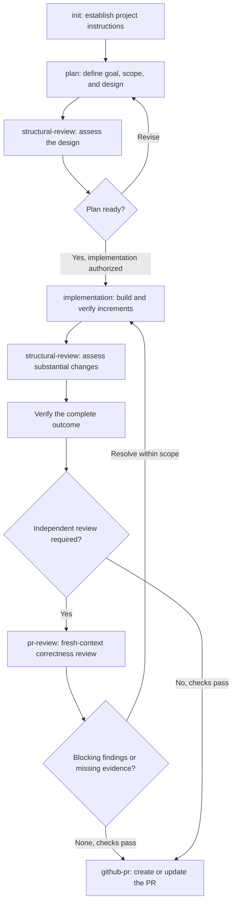

# Engineering Skills

A small set of AI coding-agent skills for taking work from an idea to a verified pull request. Plan around existing code, implement in manageable increments, and review both correctness and structure.

**Simple designs. Explicit scope. Evidence before completion.**

## Quick start

Install the full bundle into your user-level skills directory:

```sh
mkdir -p ~/.agents/skills/engineering-skills && \
  curl -fsSL https://codeload.github.com/igorrendulic/engineering-skills/tar.gz/HEAD | \
  tar -xz --strip-components=1 -C ~/.agents/skills/engineering-skills
```

Then invoke a workflow in your coding agent:

```text
$engineering-skills init
$engineering-skills plan Add password reset
$engineering-skills implementation Implement the password-reset plan
$engineering-skills github-pr Create a PR for these changes
```

The install preserves shared references and sibling skills. The workflow examples above are agent prompts, not shell commands.

## The SDLC



Start at the stage that fits the work; small, obvious changes can go straight to implementation. Independent review is required for substantial behavior changes and changes affecting security, data integrity, or shared/public contracts. Repair defaults to at most three rounds before reporting unresolved issues. Publishing, merging, and deployment follow the user's authorization.

## Workflows

| Workflow | What it does |
| --- | --- |
| [init](skills/init/SKILL.md) | Create or conservatively update root `AGENTS.md` from repository evidence. |
| [plan](skills/plan/SKILL.md) | Define success criteria, review the design, and order verifiable tasks. |
| [implementation](skills/implementation/SKILL.md) | Implement, verify, and repair supported findings within scope. |
| [structural-review](skills/structural-review/SKILL.md) | Assess ownership, complexity, reuse, and maintainability in plans or code. |
| [pr-review](skills/pr-review/SKILL.md) | Independently review correctness and regressions in fresh context. |
| [github-pr](skills/github-pr/SKILL.md) | Prepare branches, commits, and PRs with clear rationale and validation evidence. |

Plans default to `tasks/<feature-slug>/plan.md` and `todo.md`, while respecting existing project conventions. See the shared [plan lifecycle](references/plan-lifecycle.md) and [code quality principles](references/code-quality.md).

## Contributing

Add workflows under `skills/<name>/SKILL.md` and register them in the root [dispatcher](SKILL.md). Keep instructions focused, reuse shared references, and include verification appropriate to the change.
