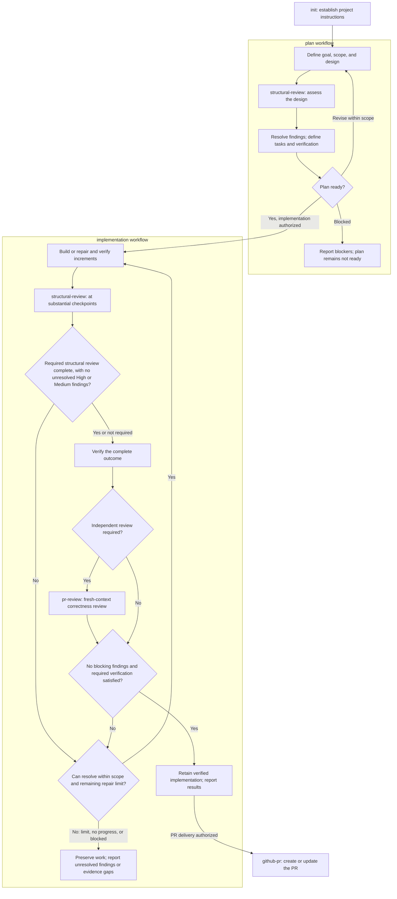

# Engineering Skills

A small set of AI coding-agent skills for taking work from an idea to a verified pull request. Plan around existing code, implement in manageable increments, and review both correctness and structure.

**Simple designs. Explicit scope. Evidence before completion.**

## Quick start

Install the native Codex plugin (tested with Codex CLI 0.162.1):

```sh
codex plugin marketplace add igorrendulic/engineering-skills --ref master
codex plugin add engineering-skills@engineering-skills
```

The remote commands require the plugin metadata to be published on `master`.
To try an unpublished checkout, register its absolute path instead of the GitHub
source in the first command, then run the same `plugin add` command:

```sh
codex plugin marketplace add /absolute/path/to/engineering-skills
codex plugin add engineering-skills@engineering-skills
```

Start a new session after installing. The plugin supplies the `engineering-skills:`
namespace; individual skills keep their short names. No MCP server or service
credentials are needed. See [OpenAI's plugin packaging guidance](https://developers.openai.com/plugins/build/plugins)
for marketplace management and client-specific setup.

Invoke a workflow or ask for help:

```text
$engineering-skills:help
$engineering-skills:help plan
$engineering-skills:init Initialize this project's AGENTS.md
$engineering-skills:plan Add password reset
$engineering-skills:implementation Implement the password-reset plan
$engineering-skills:pr-review Review the password-reset changes
$engineering-skills:github-pr Create a PR for these changes
```

Help explains workflows, inputs, outputs, and examples without executing them.
The workflow examples are agent prompts, not shell commands. The package preserves
shared references and sibling skills.

`plan` includes structural design review. `implementation` includes structural review at substantial checkpoints and independent `pr-review` when required, with repairs and re-review. The example makes `pr-review` explicit before PR creation; an existing review can be reused while its scope, snapshot, and evidence still apply.

## The SDLC



Start at the stage that fits the work; small, obvious changes can go straight to implementation. Review steps inside each workflow are invoked by that workflow. Independent review is required for substantial behavior changes, changes affecting security, data integrity, or shared/public contracts, and whenever the user or repository requires it. Explicit review waivers must be disclosed. The review-and-fix loop defaults to at most three repair rounds, each including a fresh follow-up review; it stops earlier when progress or authorization is blocked. Missing required evidence prevents completion. Publishing, merging, and deployment follow the user's authorization.

## Workflows

| Workflow | What it does |
| --- | --- |
| [init](skills/init/SKILL.md) | Create or conservatively update root `AGENTS.md` from repository evidence. |
| [plan](skills/plan/SKILL.md) | Define success criteria, review the design, and order verifiable tasks. |
| [implementation](skills/implementation/SKILL.md) | Implement, verify, and repair supported findings within scope. |
| [structural-review](skills/structural-review/SKILL.md) | Assess ownership, complexity, reuse, and maintainability in plans or code. |
| [pr-review](skills/pr-review/SKILL.md) | Independently review correctness and regressions in fresh context. |
| [github-pr](skills/github-pr/SKILL.md) | Prepare branches, commits, and PRs with clear rationale and validation evidence. |
| [help](skills/help/SKILL.md) | Explain usage and workflow selection without executing a workflow. |

Plans default to `tasks/<feature-slug>/plan.md` and `todo.md`, while respecting existing project conventions. See the shared [plan lifecycle](references/plan-lifecycle.md) and [code quality principles](references/code-quality.md).

## Contributing

Add workflows under `skills/<name>/SKILL.md` and register them in the root [dispatcher](SKILL.md). Keep instructions focused, reuse shared references, and include verification appropriate to the change.

The dispatcher table is also the help catalog. Keep skill names short; the plugin
manifest owns the namespace. See [local checks](evals/README.md) for package loading,
installer regression tests, and skill evaluation. Bump the manifest version when
releasing changed plugin contents so installed versions remain identifiable.
